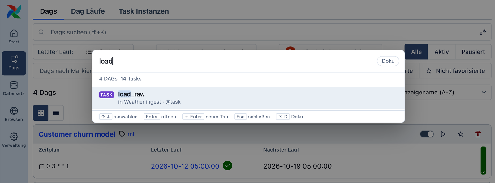
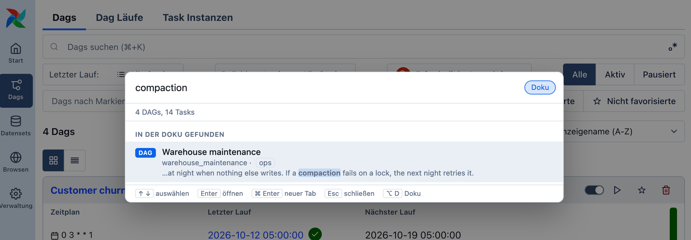

# Airflow Fuzzy Search

A Cmd+K for the Airflow 3 web UI that searches everything. Press Cmd+K (Ctrl+K on Windows and
Linux) on any page, type a few letters of a DAG or a task, in any order and without caring about
underscores, and jump there.

Nothing fancy. Most tools people work in every day now have a Cmd+K that finds anything from a few
letters, and once you are used to that, you want it everywhere. This plugin brings that kind of
search to Airflow.

> **Built by AI, not reviewed by a human.** Every line of this repository, code and documentation
> alike, was written by an AI coding agent (Anthropic's Claude, working in Claude Code). No human
> has reviewed the code. The maintainer uses the plugin on their own Airflow instance and it works
> there, but that is the extent of the testing. Please read the code before you install it anywhere
> it matters. It is small: one Python file and one JavaScript file.

## How it differs from Airflow's own search

Airflow's search matches what you type as one piece of text, and since Airflow 3.2.2 from the
start of a name unless you switch on "match anywhere". That works well when you know how a name
begins. This plugin searches the way the command palettes in editors and many web apps do: it
takes your input as loose words and letters, so "sales report", "srd" and "report sales" all find
`sales_report_daily`. It only takes over the keyboard shortcut; Airflow's own search is still in its
usual place in the UI.

## What it does

The overlay opens on top of whatever page you are on and searches every DAG you are allowed to see:
its id, display name and tags, and the names and operators of all its tasks. Words can come in any
order, separators and punctuation are ignored, and a few letters are enough when they are the starts
of words. Every word you type has to match somewhere. Typing a DAG's name lists the DAG itself, not
each of its tasks; add a word from a task's name and you get the task. When you are already on a
DAG's page, that DAG and its tasks win ties.

Below the name matches, in a section of its own, the overlay lists DAGs and tasks whose
documentation mentions what you typed, with the passage that matched. Because nearly any letters
turn up somewhere in a long text, documentation is matched more strictly: each word has to appear
as the start of a word there. A small "Docs" switch next to the search field, or Alt+D (Option+D on
a Mac), turns this part off and on, and the browser remembers your choice.

Use the arrow keys and Enter to open a result, Cmd/Ctrl+Enter to open it in a new tab, and Escape
to close the overlay. With nothing typed it shows what you opened last. It follows the UI's light
or dark theme and its language; English and German are included.

## How it works, and why it is safe to run

The plugin is a React app plugin that Airflow mounts on every page. It draws nothing until you
press the shortcut, and then opens its own overlay instead of Airflow's search. Everything happens
in your browser, inside the Airflow page you are logged in to.

To build its list, the overlay calls Airflow's own public REST API, the same one the UI uses, with
the session you are already logged in with. That means it can see exactly what you can see, no
more, and Airflow itself checks every request. The plugin adds no endpoint that returns any data,
so there is nothing of its own that needs a login or could be misconfigured. Its only addition on
the server is the address that delivers its script file, which contains no data, just as Airflow
delivers its own UI code. The overlay only reads, it never changes anything, it sends nothing
anywhere but to the Airflow it was loaded from, and it puts every name and text it receives into
the page as plain text, never as HTML.

The list is kept for the browser tab's session and refreshed in the background when it is more
than a minute old. Your recently opened items and the "Docs" switch are stored in your browser.

## Requirements and limits

The plugin needs Airflow 3.3 or later, because that is where plugins can attach themselves to every
page. It has been tried with Airflow 3.3.2. Airflow calls this kind of plugin experimental, so an
Airflow upgrade may break it; in that case Cmd+K simply opens Airflow's own search again. The search
button in Airflow's header still opens Airflow's own search; only the keyboard shortcut is taken
over.

Building the list costs one API request per hundred DAGs, one per DAG for its tasks, and, while the
documentation search is on, one more per DAG for its documentation. For a few hundred DAGs that
takes a second or two. On an instance with thousands of DAGs it is thousands of requests whenever a
user's list is refreshed, and there you will want to turn the documentation search off for
everyone (see below).

## Installing

Install the package into the Python environment of your Airflow image, the one the API server runs
in, and restart the API server. Airflow finds the plugin on its own. The package is not on PyPI yet,
so install it from this repository, for example with
`pip install git+https://github.com/stoeppke/airflow-fuzzy-search`.

## Settings

There is one setting, `include_docs` in the `[fuzzy_search]` section of the Airflow configuration
(or the environment variable `AIRFLOW__FUZZY_SEARCH__INCLUDE_DOCS`). It is on by default. Set it to
`False` and nobody's browser ever loads documentation, and the "Docs" switch disappears from the
overlay. The API server reads it when it starts.

## Contributing

Issues and pull requests are welcome, though there is no promise of quick answers. If you want to
try a change, [CONTRIBUTING.md](CONTRIBUTING.md) explains how to start a throwaway Airflow with the
plugin and a few example DAGs, and how to run the tests. Contributions written with AI tools are
fine, as long as you say so.

## License

Apache License 2.0, see [LICENSE](LICENSE).
